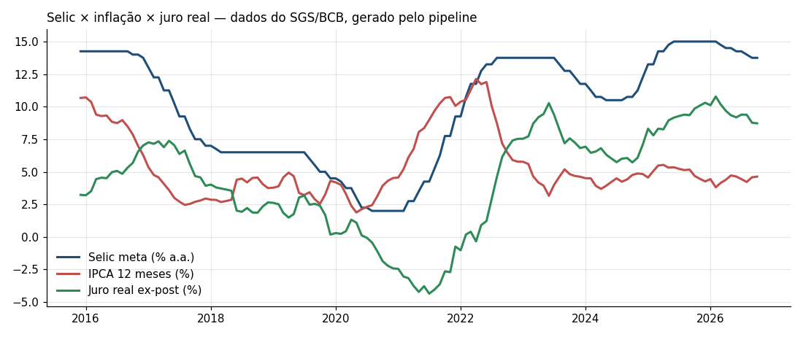

# 📈 Painel Econômico Brasil — pipeline ETL + SQL + dashboard


Pipeline de dados que **extrai** indicadores oficiais da API pública do Banco Central (SGS), **trata** os dados com pandas, **carrega** em SQLite de forma idempotente e calcula indicadores em **SQL** (IPCA acumulado em 12 meses e juro real). O resultado é exibido em um dashboard interativo com Streamlit.



## Por que este projeto
Mostra o ciclo completo de um trabalho de dados com fonte real e verificável: consumo de API, tratamento de dados sujos, modelagem em banco, consultas SQL com subconsultas e agregações, testes automatizados e integração contínua.

## Arquitetura
```
API SGS/BCB ──► extract.py ──► transform.py ──► load.py ──► SQLite ──► views SQL ──► app.py (Streamlit)
 (JSON)        retry + janelas   datas, tipos,     UPSERT      observacoes   v_ipca_12m    KPIs, gráficos,
               de 10 anos        duplicatas,                    mensal        v_juro_real   filtro de período,
                                 agregação mensal                                            download CSV
```

| Série | Código SGS | Frequência |
|---|---|---|
| IPCA – variação mensal | 433 | mensal |
| Meta Selic | 432 | diária → último valor do mês |
| Dólar PTAX venda | 1 | diária → média do mês |
| IBC-Br dessazonalizado | 24363 | mensal |

## Como executar
```bash
python -m venv .venv
.venv\Scripts\activate          # Windows  (Linux/Mac: source .venv/bin/activate)
pip install -r requirements.txt
python -m etl.pipeline --desde 2015-01-01   # baixa e carrega os dados
streamlit run app.py
pytest -q
```

## Decisões técnicas
- **Janelas de consulta:** a API do SGS limita séries diárias a 10 anos por requisição, por isso o extrator fatia o período e faz até 3 tentativas com espera exponencial.
- **Idempotência:** `INSERT ... ON CONFLICT DO UPDATE` com chave (série, data). Reexecutar o pipeline atualiza os valores sem duplicar linhas.
- **SQL portátil:** o acumulado de 12 meses usa `EXP(SUM(LN(1 + taxa)))`. Como algumas versões do SQLite no Windows não trazem essas funções, elas são registradas em Python na conexão.
- **Juro real ex-post:** `(1 + Selic) / (1 + IPCA 12m) − 1`. É uma aproximação didática, que não substitui o juro real ex-ante usado por analistas.

## Testes
Os testes não dependem de rede. Eles cobrem limpeza de datas e valores (vírgula decimal, linhas inválidas, duplicatas), agregação mensal, fatiamento das janelas, carga idempotente e o cálculo das views SQL.

## Tecnologias
Python · pandas · requests · SQLite · SQL · Streamlit · Plotly · pytest · Ruff · GitHub Actions

Fonte dos dados: [Banco Central do Brasil – Dados Abertos (SGS)](https://dadosabertos.bcb.gov.br). Os valores são da fonte oficial e não foram alterados.
